  

# 🌐 Awesome Cloud Browser OS

  
  
  
  
  
  
  

---

## 🚀 Top Cloud Browser OS Ecosystem

> **A comprehensive, community-curated directory of SaaS Desktop-as-a-Service (DaaS) platforms and open-source browser-based operating systems, Web VDI, and self-hosted cloud desktops.**

*Last updated: October 2026*

This directory tracks the evolving **Cloud Browser OS**, **Web-Native Desktop**, and **Remote Workspace** ecosystem. These technologies allow anyone to launch full-fledged GUI desktop environments, application suites, terminal tools, and persistent storage directly within modern web browsers (Chrome, Firefox, Safari, Edge)—eliminating local client installation requirements.

---

## 📑 Table of Contents

- [📊 Sector Overview & Market Dynamics](#-sector-overview--market-dynamics)
- [☁️ SaaS / Hosted Platforms](#️-saas--hosted-platforms)
- [💻 Open-Source GitHub Projects](#-open-source-github-projects)
  - [⭐ Ranked by GitHub Stars](#-ranked-by-github-stars)
  - [🛠️ Sovereign & Security-Focused Implementations](#️-sovereign--security-focused-implementations)
- [📈 Star History](#-star-history)
- [🤝 How to Contribute](#-how-to-contribute)
- [💖 Support](#-support)
- [⚖️ Disclaimer](#️-disclaimer)

---

## 📊 Sector Overview & Market Dynamics

The global **Desktop-as-a-Service (DaaS) and Cloud Browser OS** market is estimated at **$6.2 Billion in 2026** (with adjacent Browser-as-a-Service and Enterprise Browser segments adding another **$7.4 Billion**), compounding at an annual growth rate (CAGR) of **14.5% to 18.2%** toward a projected **$24+ Billion by 2032**. 

The sector exhibits **moderate-to-high market concentration** at the enterprise tier dominated by a handful of hyperscale infrastructure providers (Microsoft, Amazon AWS, Broadcom/VMware, Citrix) capitalizing on deep enterprise identity and productivity software bundles. However, the mid-market and edge layers remain **highly dynamic and fragmented**, driven by rapid innovation in browser WebAssembly (WASM), WebRTC streaming, and containerized virtualization (Kasm, Puter, Coder, DaedalOS). This creates a bifurcated landscape where hyperscalers capture enterprise compliance workloads while agile, open-source projects capture developer workstations, edge sandboxing, and sovereign privacy-first users.

---

## ☁️ SaaS / Hosted Platforms

*Below is the breakdown of the top commercial Cloud Desktop and DaaS platforms, sorted in descending order by company valuation / scale.*

| 🖥️ Product | 🏢 Company / Parent | 💼 Company Size (Market Cap / Valuation / Revenue) | 🏷️ Pricing | 🎁 Free Tier / Free Trial Limits | 📝 Description |
| :--- | :--- | :--- | :--- | :--- | :--- |
| **[Windows 365](https://www.microsoft.com/en-us/windows-365)** | Microsoft | ~$3.1T Market Cap / $245B+ Annual Revenue | Starts at $28.00/user/month (Business tier, 2 vCPU / 4 GB RAM / 64 GB storage) | 30-day free trial; limited to 1 Cloud PC per tenant across select trial SKUs (max 300 users for Business edition) | Microsoft's Cloud PC service delivering full Windows desktops to any device via browser or Remote Desktop app. Integrated with Intune and Entra ID. |
| **[Microsoft Azure Virtual Desktop](https://azure.microsoft.com/en-us/products/virtual-desktop/)** | Microsoft | ~$3.1T Market Cap / $245B+ Annual Revenue | $0 user access fee with existing M365/Windows enterprise license (or $5.50/user/mo app-only, $10.00/user/mo desktop access for external users) + Azure consumption (starts ~$10–$15/user/month multi-session) | 30-day Azure Free Trial with $200 in Azure credits to provision session hosts, compute, and storage | Cloud VDI service offering multi-session Windows 10/11, FSLogix profile management, and App Attach for MSIX packaging. |
| **[Amazon WorkSpaces](https://aws.amazon.com/workspaces/)** | Amazon (AWS) | ~$2.0T Market Cap / $575B+ Annual Revenue | Starts at $21.00/user/month (AlwaysOn Linux) or $7.25/month + $0.22/hour (AutoStop metered); Windows bundles start at $28.00/month or $9.75/month + $0.30/hour | 3 billing cycles free trial; includes up to 2 Standard bundle WorkSpaces with 80 GB root / 50 GB user storage, capped at 40 hours of combined monthly usage | Fully managed desktop-as-a-service on AWS with Windows and Linux options, WorkSpaces Web browser access, and WorkSpaces Core. |
| **[VMware Horizon](https://www.vmware.com/products/horizon.html)** | Broadcom | ~$850B Market Cap / $50B+ Annual Revenue | Starts at ~$8.25/user/month (Horizon Apps / Term subscription, billed annually) | 60-day to 90-day evaluation trial (license key provided via Broadcom portal for non-production PoC testing) | Virtual desktop and application delivery platform featuring Horizon Cloud on Azure, App Volumes, and Dynamic Environment Manager. |
| **[Citrix Workspace](https://www.citrix.com/)** | Cloud Software Group (Vista & Evergreen) | ~$16.5B Private Acquisition Valuation / ~$3.2B Annual Revenue | Starts at ~$10.00/user/month (Citrix DaaS Standard via Cloud Marketplace, annual commitment) | 60-day trial for Citrix Cloud / DaaS capped at 25 end users | Enterprise workspace platform delivering virtual apps and desktops with HDX protocol optimization and zero-trust access controls. |
| **[Nutanix Frame](https://www.nutanix.com/products/frame)** | Nutanix | ~$14.5B Market Cap / ~$2.1B Annual Revenue | Starts at ~$24.00–$30.00/user/month (1-year term commitment or PAYG with 5-user minimum) | 30-day free trial (up to $25 in hosted infrastructure consumption or BYO cloud account on Azure/AWS/GCP) | Browser-based DaaS delivering Windows and Linux desktops without client installation. |
| **[Paperspace](https://www.paperspace.com/)** | DigitalOcean | ~$3.5B Market Cap / ~$750M+ Annual Revenue | Starts at $0.0045/hour (CPU Core instances) or $0.45/hour (GPU instances) + storage starting at $5.00/month; Gradient ML has a free tier | Free plan on Paperspace Gradient with 5 GB persistent storage, free CPU/entry GPU, capped at 6-hour runtime sessions (Core desktops have no free tier) | Cloud computing and GPU-accelerated virtual desktops featuring Gradient for ML workflows and Core for persistent virtual machines. |
| **[Parallels RAS](https://www.parallels.com/products/ras/)** | Alludo (formerly Corel / KKR portfolio) | ~$1B+ Valuation (acquired by KKR) / ~$300M+ Annual Revenue | Starts at $99.99/concurrent user/year (~$8.33/concurrent user/month equivalent) | 30-day free trial with full feature access for up to 50 concurrent users | Application and virtual desktop delivery platform featuring HTML5 browser client and native client support across platforms. |
| **[Kasm Cloud](https://kasm.com/)** | Kasm Technologies | ~$9.6M Estimated Private Valuation / ~$3M Annual Revenue | Starts at $10.00/month (Cloud Browser tier, 100 hrs/month) or $20.00/month (Cloud Desktop tier, 200 hrs/month) | Self-hosted Kasm Community Edition is free forever for up to 5 concurrent sessions; Cloud service has no free tier (entry paid plan starts at $10/mo) | Managed cloud streaming containerized browsers, desktops, and apps via web browser with SOC 2 Type II attestation. |
| **[Shells](https://shells.com/)** | Shells.com Inc. | ~$2.4M Venture Funding Raised / Early-Stage Startup | Starts at $4.95/month (Shells Lite plan, 10 hours/month) or $14.95/month (Basic plan, unlimited usage) | 7-day money-back guarantee with test run entry tier (Lite plan at $4.95 for 10 hours); no perpetual free tier | Personal cloud desktop provider offering browser-based access, persistent storage, and Linux/Windows environments. |

---

## 💻 Open-Source GitHub Projects

Open-source web desktops and cloud workstations empower developers, self-hosters, and enterprises to own their data and eliminate vendor lock-in.

### ⭐ Ranked by GitHub Stars

*Sorted in descending order by GitHub stargazer count:*

1. **[Code-Server](https://github.com/coder/code-server)**   
   📦 **VS Code in the browser.** Run VS Code on any remote machine and access it through any browser. Built by Coder, it provides consistent dev environments, multi-platform access, and heavy compute offloading for cloud-first developer workflows.

2. **[Puter](https://github.com/HeyPuter/puter)**   
   🌐 **The Internet OS! Free, Open-Source, and Self-Hostable** (AGPL-3.0). Puter is an advanced desktop environment running in browser tabs with privacy-first storage, an app store (code editor, terminal, office apps), terminal AI, and free subdomain hosting (`puter.site`). Includes `puter.js` SDK.

3. **[Coder](https://github.com/coder/coder)**   
   ☁️ **Self-hosted Cloud Development Environments (CDEs).** Provisions full Linux/Windows developer workspaces via Terraform across Kubernetes, Docker, AWS, GCP, and bare metal with Web-based IDE and terminal access.

4. **[noVNC](https://github.com/novnc/noVNC)**   
   🖥️ **VNC client WebAssembly / JavaScript library.** Uses HTML5 Canvas and WebSockets to render remote desktop sessions in any modern browser without plugins. Core building block of many web desktop projects.

5. **[Gitpod](https://github.com/gitpod-io/gitpod)**   
   ⚡ **Developer Platform for Cloud Workspaces.** Automates the provisioning of ready-to-code cloud developer environments directly from your browser.

6. **[daedalOS](https://github.com/DustinBrett/daedalOS)**   
   🎨 **Desktop environment in the browser.** Written in React and TypeScript, daedalOS replicates a modern Windows-like desktop with file system emulation, media players, terminal, emulators, and rich web app integrations.

7. **[Windows 11 Web](https://github.com/blueedgetechno/windows11)**   
   🪟 **Windows 11 replica made in React.** Features the Fluent Design System, interactive Start Menu, Edge browser, widgets panel, notepad, calculator, and terminal right inside a browser tab.

8. **[OS.js](https://github.com/os-js/OS.js)**   
   🧩 **An open-source JavaScript web desktop platform.** Provides an extensible window manager, GUI toolkit, filesystem abstractions, and modular application ecosystem.

9. **[KasmVNC](https://github.com/kasmtech/KasmVNC)**   
   🚀 **Modern web-native VNC server.** Designed specifically for browser streaming with WebRTC support, VP8/VP9/AV1 video encoding, lossless image compression, and low-latency interaction.

10. **[Docker Webtop](https://github.com/linuxserver/docker-webtop)**   
    🐳 **Linux desktop environments in Docker containers.** Delivers full XFCE, KDE, MATE, i3, and Openbox desktop sessions rendered over HTTP/HTTPS in the browser via KasmVNC/Rasm.

11. **[Apache Guacamole Server](https://github.com/apache/guacamole-server)**   
    🛡️ **Clientless remote desktop gateway.** Translates RDP, VNC, and SSH protocols into standard web socket streams for zero-install browser access.

12. **[Awesome Web Desktops](https://github.com/syxanash/awesome-web-desktops)**   
    📚 **Curated index of web desktop environments.** Tracks creative browser OS experiments, historical WebOS implementations, and interface experiments.

13. **[Kasm Workspaces Images](https://github.com/kasmtech/workspaces-images)**   
    🖼️ **Official Docker build files for Kasm containerized apps and desktops.** Includes specialized OSINT research containers, developer setups, and isolated web browsers.

14. **[Kasm Workspaces Core Images](https://github.com/kasmtech/workspaces-core-images)**   
    ⚙️ **Core base container images for streaming desktop workloads.** Used as the foundation for containerized workspace deployments.

15. **[Docker RDesktop](https://github.com/linuxserver/docker-rdesktop)**   
    🖥️ **Lightweight containerized remote desktop client.** Web browser access to remote desktop sessions running Alpine or Ubuntu.

16. **[Web Desktop Environment (shmuelhizmi)](https://github.com/shmuelhizmi/web-desktop-environment)**   
    💻 **Modern web-based cross-platform desktop UI.** Includes window management, file browser, and built-in interactive utilities.

17. **[Open Web Desktop (OWD)](https://github.com/owdproject/client)**   
    🛠️ **TypeScript & Nuxt.js Web Desktop Framework.** Fully extensible through themes, apps, and modules, styled with Tailwind and PrimeVue.

18. **[Vulos OS](https://github.com/vul-os/vulos)**   
    🔒 **Sovereign, web-native personal operating system.** Native-first dispatch routing across web apps, CPU app streams (Xvfb + WebRTC), GPU routes, and local workers with Go backend.

19. **[PC2 (Elacity)](https://github.com/Elacity/pc2.net)**   
    🍓 **Sovereign Internet OS for Raspberry Pi.** Runs WASM apps locally on your node with cryptographic key access and decentralized wallet identity.

20. **[Slime OS](https://github.com/mulai/slimeos)**   
    🛡️ **Cloud-First Hardened Operating System.** Three-component architecture (Membrane, Brain, App) wrapped in WireGuard + Authelia zero-trust networking.

21. **[OS.js Web Desktop (AnEntrypoint)](https://github.com/AnEntrypoint/osjs-webdesktop)**   
    💾 **Production-ready OS.js distribution with polymorphic JSON state session management.**

---

### 🛠️ Sovereign & Security-Focused Implementations

- **[Gooroom Platform](https://gooroom.kr/)**: Debian-based cloud OS developed by the South Korean Ministry of Science and ICT, enforcing dual-process browser isolation for trusted and untrusted networks.
- **[Kasm Workspaces Community Edition](https://kasm.com/community-edition)**: Web-native rendering technology streaming containerized workspaces with 5 concurrent sessions free forever for non-commercial use.

---

## 📈 Star History

---

## 🤝 How to Contribute

Contributions are warmly welcomed! To suggest a new Cloud OS, DaaS platform, or open-source web desktop:

1. 🍴 **Fork the repository**.
2. 📝 **Add your entry** under the appropriate category (`SaaS` or `Open-Source`).
3. 🏷️ **Follow the formatting conventions**:
   - For SaaS: Fill all table columns with verifiable starting price, free tier/trial limits, and parent company details.
   - For Open-Source: Include the social white star badge linking to the repository stargazers page, maintain descending star order, and provide a clear 1–2 sentence description.
4. 🚀 **Submit a Pull Request** with a brief summary of the project and why it belongs here.

---

## 💖 Support

Thank you so much for exploring the **Awesome-Cloud-Browser-OS** repository! 🙏

If this curated list saved you research time or inspired your cloud infrastructure setup:
- ⭐ **Star this repository** to show your appreciation and help other developers discover it!
- 🍴 **Fork and share** with colleagues, devops teams, and open-source communities.
- ☕ **Buy me a coffee**: If you'd like to support ongoing curation and maintenance, visit the [Sponsor Dashboard](https://github.com/sponsors/ishandutta2007).

---

## ⚖️ Disclaimer

- This is an independent, **community-curated index** for informational and educational purposes — not a commercial endorsement.
- Cloud desktop platforms handling user data, session credentials, and confidential workloads must comply with data protection regulations (GDPR, CCPA, HIPAA, SOC 2) and implement rigorous zero-trust access controls.
- **Self-hosting considerations**: Deploying open-source cloud desktops requires appropriate infrastructure, TLS configuration, port hardening, and regular patching. Ensure remote desktop streams (VNC, RDP) are encapsulated inside VPNs or WebRTC relays rather than exposed raw to the public internet.
